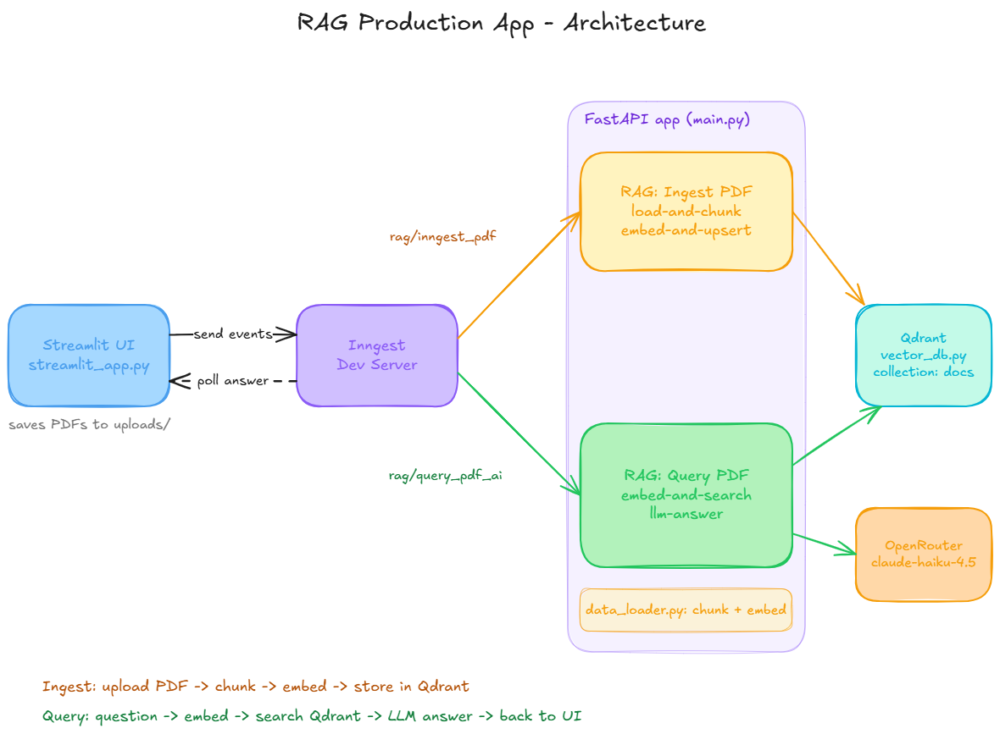

# RAG Production App

A Retrieval-Augmented Generation (RAG) app that lets you upload PDFs and ask questions about them. Answers are generated from the most relevant chunks of your documents, along with the sources they came from.

Ingestion and querying run as event-driven workflows using [Inngest](https://www.inngest.com/), so every step is observable and retryable.

## Features

- Upload PDFs through a simple Streamlit interface
- Automatic chunking and embedding of each PDF
- Vector search with [Qdrant](https://qdrant.tech/) (cosine similarity)
- Answers generated via [OpenRouter](https://openrouter.ai/) (`anthropic/claude-haiku-4.5`)
- Shows the source documents used for each answer
- Adjustable number of retrieved chunks (top-k)

## Architecture



**Ingest:** upload PDF → chunk → embed → store in Qdrant
**Query:** question → embed → search Qdrant → LLM answer → back to the UI

| File | Purpose |
|------|---------|
| `streamlit_app.py` | Web UI: PDF upload and question form |
| `main.py` | FastAPI app that serves the Inngest functions (`RAG: Ingest PDF`, `RAG: Query PDF`) |
| `data_loader.py` | PDF loading, chunking and embeddings |
| `vector_db.py` | Qdrant wrapper (`upsert` and `search`) |
| `custom_types.py` | Pydantic models shared between steps |
| `pyproject.toml` / `uv.lock` | Dependencies, managed with [uv](https://docs.astral.sh/uv/) |

## Requirements

- Python (version in `.python-version`)
- [uv](https://docs.astral.sh/uv/getting-started/installation/)
- [Docker](https://www.docker.com/) (to run Qdrant)
- [Node.js](https://nodejs.org/) (to run the Inngest dev server)
- An [OpenRouter](https://openrouter.ai/) API key

## Getting Started

**1. Clone and install**

```bash
git clone https://github.com/USERNAME/REPO.git
cd REPO
uv sync
```

**2. Configure environment variables**

```bash
cp .env.example .env
```

Then edit `.env`:

```
OPENROUTER_API_KEY=your_key_here
```

> Never commit `.env`. It is listed in `.gitignore`.

**3. Run the services** (each in its own terminal)

```bash
# 1) Qdrant vector database (runs in Docker; after the first run, just start it again from Docker Desktop or with `docker start qdrantRagDB`)
docker run -d --name qdrantRagDB -p 6333:6333 -v ./qdrant_storage:/qdrant/storage qdrant/qdrant

# 2) FastAPI app (Inngest functions)
uv run uvicorn main:app --reload

# 3) Inngest dev server
npx inngest-cli@latest dev -u http://127.0.0.1:8000/api/inngest

# 4) Streamlit UI
uv run streamlit run streamlit_app.py
```

- Streamlit UI: http://localhost:8501
- Inngest dashboard: http://localhost:8288
- Qdrant dashboard: http://localhost:6333/dashboard

## Usage

1. Open the Streamlit app and upload a PDF.
2. Wait for the ingestion to finish (you can follow it in the Inngest dashboard).
3. Type a question, choose how many chunks to retrieve, and click **Ask**.
4. Read the answer and the list of sources.

## Configuration

| Variable | Description | Default |
|----------|-------------|---------|
| `OPENROUTER_API_KEY` | API key used for the LLM | required |
| `INNGEST_API_BASE` | Inngest API URL used by the UI | `http://127.0.0.1:8288/v1` |

## Tech Stack

Python · Streamlit · FastAPI · Inngest · Qdrant · OpenRouter · uv

## License

Add a license of MIT.